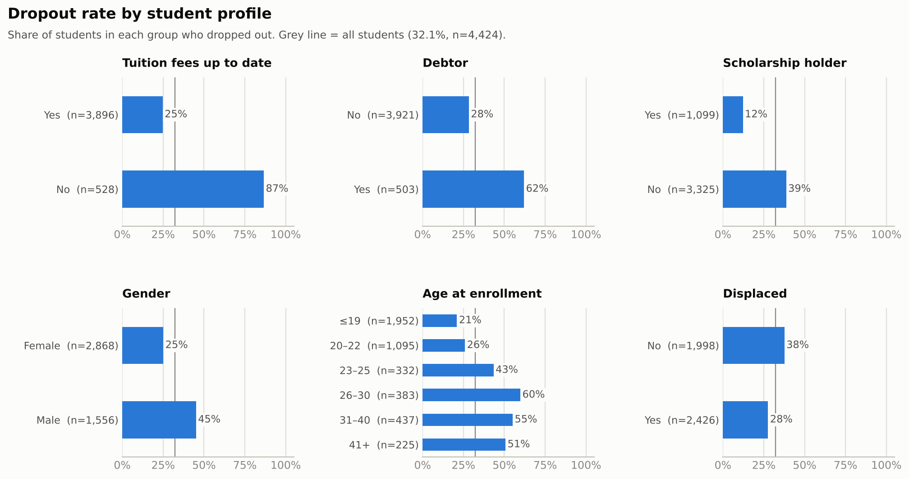
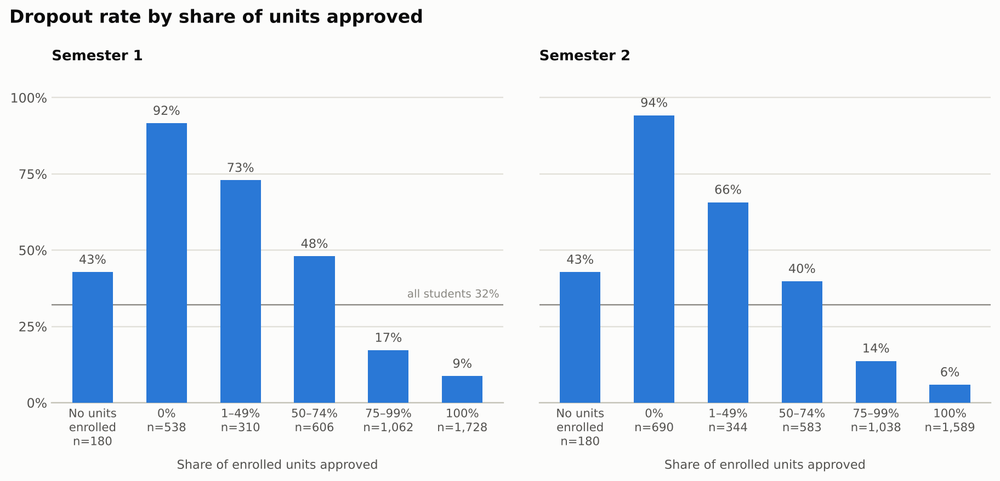
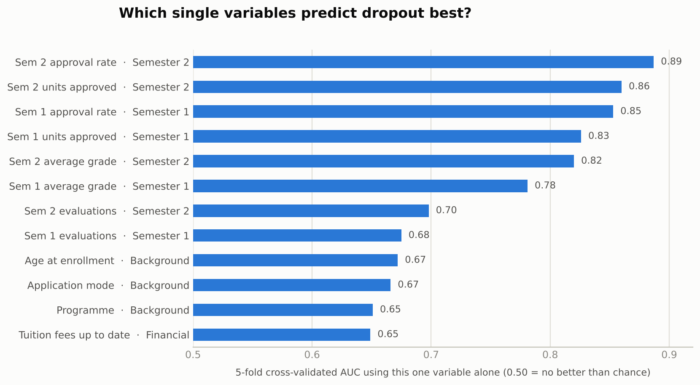
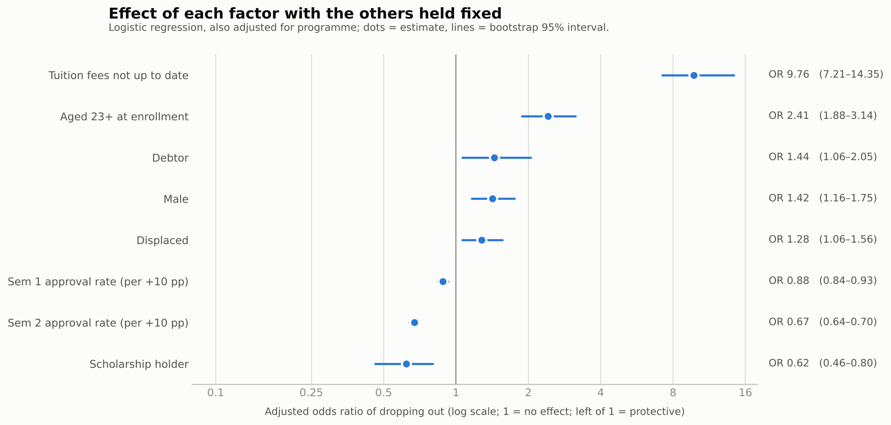
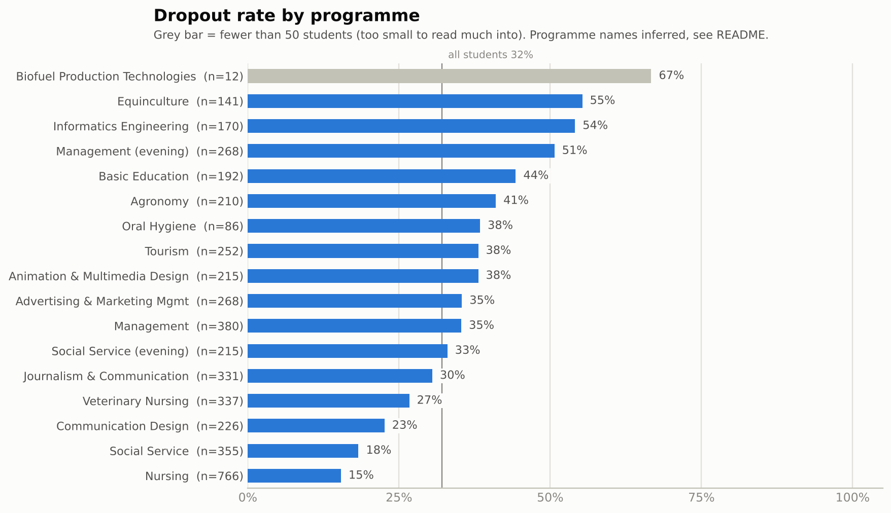
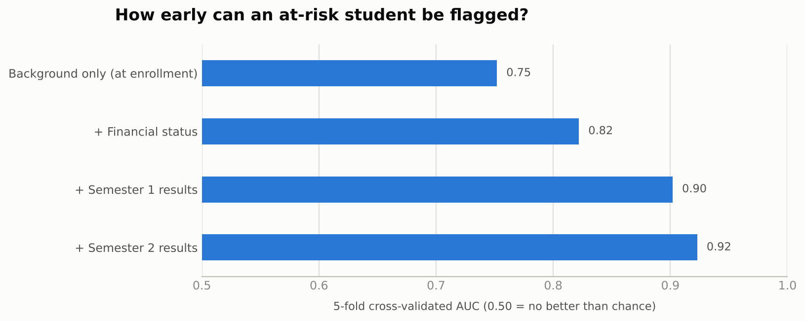

# Student Dropout Analysis

**Which students drop out of higher education, and how early can we tell?**

Exploratory analysis and early-warning check on 4,424 undergraduate students from a Portuguese higher-education institution. Built with Python (pandas, SciPy, scikit-learn, matplotlib).

## TL;DR

- **32.1%** of students dropped out (1,421 of 4,424). 49.9% graduated and 17.9% were still enrolled at the end of the normal course length.
- **Money and early academic progress dominate.** 86.6% of students whose tuition fees were not up to date dropped out, versus 24.7% of those who were up to date. Students who passed none of their semester-1 units dropped out 91.6% of the time (n=538); those who passed all of them, 8.7% (n=1,728).
- **Profile matters too.** Dropout is 12.2% for scholarship holders versus 38.7% for everyone else, 59.8% for students who enrolled aged 26–30 versus 21.0% for those aged 19 or younger, and 45.1% for men versus 25.1% for women.
- **A simple two-part rule works surprisingly well after semester 1:** "tuition not up to date, or 2 or fewer units approved" flags 28.4% of students. 76.7% of those flagged dropped out, and the rule catches 67.9% of all dropouts (in-sample, see limitations).
- **Early signal:** a model using only enrollment background reaches AUC 0.75. Adding financial status gives 0.82, semester-1 results 0.90, and semester-2 results 0.92.

## Data

- Source: *Predict Students' Dropout and Academic Success* (Realinho et al.), a Kaggle copy of the UCI dataset. See the reference at the bottom.
- This copy has **4,424 rows × 35 columns**, no missing values and no duplicate rows. Other copies list 37 columns; this one does not include *Previous qualification (grade)* or *Admission grade*, so they are not used here.
- Target has three classes: Graduate (2,209), Dropout (1,421) and Enrolled (794).
- **Definition used everywhere:** dropout = 1 if `Target == "Dropout"`, otherwise 0. "Enrolled" students are still studying, so their final outcome is unknown; they are counted as not (yet) dropped out. A sensitivity check that removes them is in the modelling section.
- Course codes are re-numbered 1–17 in this copy. The programme names in the charts are **inferred** from the sorted order of the original programme codes. One check supports this: the only two codes with no daytime students (3 and 17) match the two evening programmes in the original data. Treat the names as labels for readability, not as verified facts.
- `Gender` is assumed to follow the original coding (1 = male).

## Method

1. **Quality checks:** missing values, duplicates, ranges, consistency (approved units never exceed enrolled units).
2. **Descriptive rates:** dropout rate by group, with chi-square tests for binary factors.
3. **Single-variable power:** 5-fold cross-validated AUC of a gradient-boosting model that sees one variable at a time.
4. **Stage-wise models:** how much does each new piece of information improve prediction (background → finance → semester 1 → semester 2)?
5. **Adjusted effects:** logistic regression adjusted for programme, with bootstrap 95% intervals (300 resamples).
6. **Rule check:** precision and recall of a simple, explainable flag.

## Findings

### 1. Finance is the sharpest dividing line



| Group | Dropout rate | Comparison |
|---|---|---|
| Tuition fees not up to date (n=528) | 86.6% | 24.7% if up to date |
| Debtor (n=503) | 62.0% | 28.3% if not |
| Scholarship holder (n=1,099) | 12.2% | 38.7% if not |

All three gaps are statistically very strong (chi-square p < 1e-50). With everything else held fixed, unpaid tuition still carries an odds ratio of about 9.8 (95% CI 7.2–14.4) and a scholarship about 0.62 (0.46–0.80).

Unpaid tuition looks weak in the single-variable AUC chart (0.65) only because few students have it (11.9%). Those who do are flagged very reliably (87% dropped out).

### 2. Early academic progress is the strongest single signal



The share of enrolled units a student passes in semester 2 is the best single predictor of any variable (AUC 0.89), followed by the same measure for semester 1 (0.85).



A separate group of 180 students enrolled in no units in either semester. Their dropout rate (42.8%) sits between the extremes, so they are treated as their own group rather than as "0% passed".

### 3. Older students and men drop out more

Dropout rises from 21.0% (aged 19 or younger) and 25.9% (20–22) to 43.4% (23–25) and 59.8% (26–30). After adjustment, being 23 or older has an odds ratio of 2.41 (1.88–3.14) and being male 1.42 (1.16–1.75).



The 23-year cut-off was chosen after looking at the age pattern, so treat it as descriptive.

### 4. Programmes differ a lot



Among programmes with at least 50 students, dropout ranges from 15.4% (Nursing, n=766) and 18.3% (Social Service, n=355) up to 55.3% (Equinculture, n=141) and 54.1% (Informatics Engineering, n=170). Programme differences partly reflect who enrolls (for example age), so they are not a verdict on teaching quality.

### 5. A reversal worth knowing about: "Displaced"

Raw numbers suggest displaced students drop out *less* (27.6% versus 37.6%). That is a confounding effect of age: displaced students are much younger (mean age 20.8 versus 26.3). Comparing students of similar age, the gap disappears: under 23, 22.9% (displaced) versus 22.3%; aged 23+, 53.5% versus 52.6%. The full model still shows a small residual odds ratio of 1.28 (1.06–1.56), which I would not lean on.

### 6. What did not show a clear effect

- **International students** (29.1% versus 32.2%, p=0.49, n=110) and **special educational needs** (33.3% versus 32.1%, p=0.85, n=51): too few students to say anything.
- **Macro-economic indicators** (unemployment, inflation, GDP): only 10 distinct combinations exist in the data, so they identify cohorts, not individuals. Their correlation with dropout is between −0.05 and 0.03. They were left out of the models.

## How early can we flag at-risk students?



| Information available | Features | CV AUC | AUC, dropout vs graduate only |
|---|---|---|---|
| Background at enrollment | 16 | 0.752 | 0.773 |
| + financial status | 19 | 0.822 | 0.848 |
| + semester 1 results | 26 | 0.902 | 0.936 |
| + semester 2 results | 33 | 0.923 | 0.955 |

(5-fold stratified cross-validation, gradient boosting, untuned. The last column drops "Enrolled" students as a sensitivity check; conclusions are the same.)

An explainable rule does most of the work:

| Rule | Students flagged | Dropped out among flagged | Share of all dropouts caught |
|---|---|---|---|
| Tuition fees not up to date | 11.9% | 86.6% | 32.2% |
| Semester 1: 2 or fewer units approved | 22.7% | 77.1% | 54.5% |
| Either of the above | 28.4% | 76.7% | 67.9% |
| Either, or semester 2: 2 or fewer units approved | 32.9% | 74.6% | 76.4% |

## What an institution could try (hypotheses, not proven causes)

1. Treat a missed tuition payment as an immediate trigger for outreach, such as financial counselling or a payment plan.
2. After semester 1, offer academic support to students who passed 2 or fewer units. Dropout is 91.6% for students who passed none of their enrolled units and 72.9% for those who passed under half.
3. Give extra attention to mature students and to men, who drop out more even after adjustment.
4. Test any intervention with a small pilot before scaling it. Scholarships are associated with much lower dropout, but this data cannot show that scholarships cause it.

## Limitations

- **Observational data:** associations, not causes.
- **Timing and reverse causation:** unpaid tuition and semester-2 results may partly be *consequences* of a student already leaving, so the accuracy of the later stages overstates how early the risk could really be caught. Semester 1 is the more realistic early-warning point.
- **Rules and thresholds were picked after looking at the same data** (in-sample, no held-out test), so the precision and recall figures are optimistic.
- **"Enrolled" outcomes are unknown**, which affects every rate.
- One institution in one country; results may not transfer elsewhere.
- Programme names are inferred (see Data), and two original columns are missing from this copy.
- Models were not tuned, and cross-validation was run once with a fixed seed.

## Reproduce

```bash
pip install -r requirements.txt
python analysis.py
```

Runs in about 30 seconds and rewrites everything in `figures/` and `outputs/`.

```
data/dataset.csv              input data (Kaggle copy)
analysis.py                   full analysis, figures and tables
figures/                      six PNG charts used above
outputs/                      CSV tables, results.json, run_log.txt
requirements.txt
```

## Reference

Realinho, V., Machado, J., Baptista, L., & Martins, M.V. (2022). Predicting Student Dropout and Academic Success. *Data*, 7(11), 146. https://doi.org/10.3390/data7110146

Dataset: Realinho, V., Machado, J., Baptista, L., & Martins, M.V. (2021). *Predict students' dropout and academic success* (v1.0) [Data set]. Zenodo. https://doi.org/10.5281/zenodo.5777340
